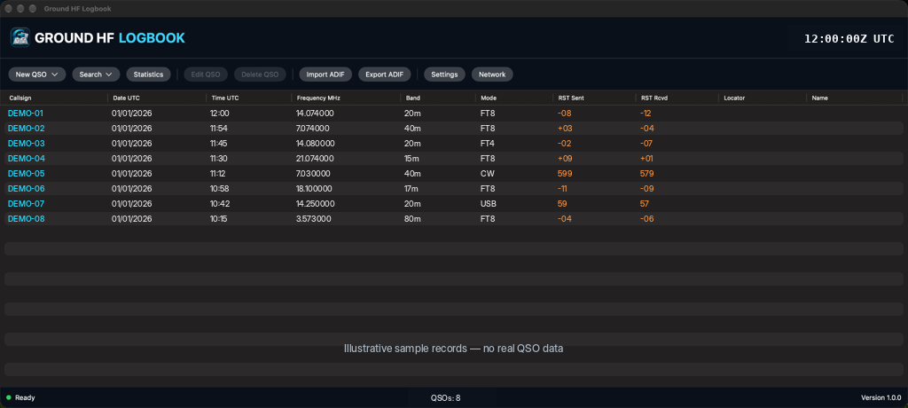

<h1 align="center">Ground HF Logbook</h1>

<strong>Native macOS Amateur Radio Logging</strong> Built for the hobby. Designed for Apple Silicon.

  

## Official downloads — v1.0.0 Public Beta

For Apple Silicon Macs running macOS 27.2 or later. Download directly from this table; these are the seven official distribution files.

| File | Direct download |
|---|---|
| DMG installer · recommended | **[Download DMG (7.93 MB)](https://github.com/andyhl2M7SBC/Ground-HF-Logbook-Releases/releases/download/v1.0.0/Ground-HF-Logbook-v1.0.0.dmg)** |
| ZIP application | [Download ZIP (7.06 MB)](https://github.com/andyhl2M7SBC/Ground-HF-Logbook-Releases/releases/download/v1.0.0/Ground-HF-Logbook-v1.0.0.zip) |
| Installation and Gatekeeper guide | [PDF](https://github.com/andyhl2M7SBC/Ground-HF-Logbook-Releases/releases/download/v1.0.0/Ground-HF-Logbook-v1.0.0-Gatekeeper-Installation.pdf) |
| Complete user guide | [PDF](https://github.com/andyhl2M7SBC/Ground-HF-Logbook-Releases/releases/download/v1.0.0/Ground-HF-Logbook-v1.0.0-User-Guide.pdf) |
| Release notes | [PDF](https://github.com/andyhl2M7SBC/Ground-HF-Logbook-Releases/releases/download/v1.0.0/Ground-HF-Logbook-v1.0.0-Release-Notes.pdf) |
| DMG verification | [SHA-256 checksum](https://github.com/andyhl2M7SBC/Ground-HF-Logbook-Releases/releases/download/v1.0.0/Ground-HF-Logbook-v1.0.0.dmg.sha256) |
| ZIP verification | [SHA-256 checksum](https://github.com/andyhl2M7SBC/Ground-HF-Logbook-Releases/releases/download/v1.0.0/Ground-HF-Logbook-v1.0.0.zip.sha256) |

**Important:** The application is ad-hoc signed and unnotarised; the DMG is unsigned. Gatekeeper rejected the quarantined app in local testing. Read the [installation guide](https://github.com/andyhl2M7SBC/Ground-HF-Logbook-Releases/releases/download/v1.0.0/Ground-HF-Logbook-v1.0.0-Gatekeeper-Installation.pdf) before installing. If macOS blocks the app, verify the checksum and follow Apple's per-app Open Anyway procedure if available. If macOS reports damage, offers Move to Bin or provides no override, stop and report the exact message. Keep Gatekeeper enabled.

Independent installation testing and confirmation of artwork rights, freeware terms and provider terms remain pending.

## About

Ground HF Logbook is an independent native macOS amateur radio logging application. Reliability before complexity, a clear operating interface and progressive, tested development are central to its design.

## Current features

- Manual QSO logging, editing, deletion and local database storage.
- ADIF import and export with duplicate protection.
- Callsign search, band and mode filtering, and operating statistics.
- TCI frequency and mode synchronisation.
- Independent WSJT-X UDP logging.
- QRZ and HamQTH station lookup with secure Keychain credential storage.
- Integrated station mapping, satellite views, distances and antenna bearings.
- Operator settings, Connection Centre, welcome window and offline Help.

Local release testing covered clean first launch, update preservation, manual logging, ADIF and synthetic TCI/UDP traffic. Wider live radio, lookup and mapping verification remains pending.

## Application preview

*Application interface with fictional demonstration rows. No personal station details or real contacts are shown.*

## Documentation

The three PDF guides are available directly from the downloads table above. The application also includes offline Help.

## Future development

Proposed developments include online logging and electronic QSL services, enhanced statistics and awards tracking, backup and recovery improvements, contest logging, and further integration with the Ground HF software family. These are plans, not promised features or deadlines.

## Support

- [Report a bug](https://github.com/andyhl2M7SBC/Ground-HF-Logbook-Releases/issues/new?template=bug-report.yml)
- [Request a feature](https://github.com/andyhl2M7SBC/Ground-HF-Logbook-Releases/issues/new?template=feature-request.yml)
- [Browse existing reports](https://github.com/andyhl2M7SBC/Ground-HF-Logbook-Releases/issues)

Reports are public and require a GitHub account. Include the app version, macOS version and steps to reproduce. Remove credentials, personal callsigns, grid locators, connection details and QSO records.

## Distribution and source code

This repository is for official binary releases, documentation and support. Application development source remains private. GitHub's automatic source archives for v1.0.0 contain only the public support README and issue templates, not the Swift application source.

Free distribution is intended; proposed terms and third-party notices are included in the package, with final rights confirmation pending.

---

<strong>Built for amateur radio. Designed for macOS.</strong> GROUND HF SOFTWARE

